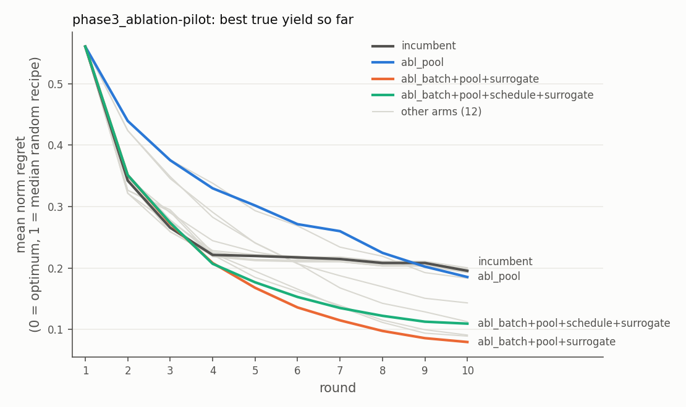

# Pilot results (machinery check, 2026-10-14)

**These are pilot runs.** They use 10 problems (one per landscape subtype at 12 factors,
plus Borkowski), 2 to 4 seeds, a cheaper incumbent (15 hyperparameter draws instead of
200) and smaller candidate pools. Their job is to show that every part of the pipeline
runs end to end, and to surface problems before the expensive confirmatory runs. They
are **not** evidence for or against any intervention, and nothing below passed the
preregistered significance test. The full tables are in `results/SUMMARY-pilot.md`
(regenerate with `python -m metis_bench summary --pilot`).

Regret is normalised: 0 = the exact optimum, 1 = the median random recipe. Lower is better.

## What the pilots found

### 1. The candidate pool caps METIS (the most important finding)

METIS scores a pool of uniformly random recipes and proposes the best ones, so the pool
*is* its acquisition optimiser. On every hard landscape the arms plateaued at the same
recipe within two or three rounds. On a smooth 12-factor function:

| candidate source | best true yield (fraction of optimum) |
| --- | --- |
| random pool, 2,000 recipes | 0.69 |
| random pool, 10,000 recipes (METIS notebook default) | 0.81 |
| random pool, 100,000 recipes (paper) | 0.83 |
| 8 greedy local steps from the best random recipe | 0.98 |

This is why the initial design, surrogate and batch rule barely moved final regret:
none of them can reach recipes the pool never offers. It led to **amendment 1**: a
candidate-pool intervention (`metis.pools.LocalPool`, family F3c) that fills half the pool
with 1 to 3-factor mutations of the best measured recipes. The default random pool is
unchanged, verified bit for bit against a finished pilot run.

| problems | incumbent | local pool |
| --- | --- | --- |
| hard (all factors active) | 0.414 | 0.386 |
| Borkowski gold oracle | 0.064 | **0.019** |
| easy (3 to 5 active factors) | 0.005 | 0.050 |

The local pool helps where the ceiling binds and over-exploits where it doesn't. An
adaptive share (more local moves once random pools stop improving) is the obvious
next candidate, and the full benchmark should tune `local_share`.

### 2. Recommendations suffer from the winner's curse

The recipe an experimenter carries forward (best *measured* mean) is often worse than
the best recipe actually measured. On the Fig. 1b check, METIS v1 measured a recipe at
0.028 normalised regret (true yield 2.56 against the oracle optimum of 2.62), but its
recommendation sat at 0.27, worse than random search's 0.19. Many near-optimal recipes plus outlier wells mean the top measured
mean is often a lucky one. Feeding replicate SDs into the surrogate lowered
recommendation regret slightly (XGB 0.324 -> 0.306, GP 0.315 -> 0.309). The
preregistration tracks this secondary endpoint, and a recommendation rule that uses the
surrogate rather than raw means is worth testing.

### 3. Surrogates differ sharply in calibration, little in final regret

Median over problems, seeds and guided rounds, on held-out random designs against
noise-free truth:

| surrogate | R2 | Spearman | 80% interval coverage | 95% coverage | standardised-error SD (1 = calibrated) |
| --- | --- | --- | --- | --- | --- |
| XGBoost ensemble (incumbent) | 0.42 | 0.80 | 0.30 | 0.50 | 2.0 (overconfident) |
| Matern GP | 0.85 | 0.87 | 0.88 | 0.96 | 0.85 |
| TabPFN | 0.87 | 0.92 | 0.93 | 0.99 | 0.69 (covers noise too, see below) |

Final regret moved little (GP -0.004, TabPFN -0.003 vs the incumbent), as the pool
ceiling predicts. The incumbent's ensemble spread is not a predictive uncertainty: its
nominal 80% intervals contain the truth about 30% of the time, so UCB's exploration term means
something different from what its coefficient suggests. TabPFN's std describes a noisy
measurement, so it over-covers noise-free truth by construction. On CPU it costs about 10
minutes per pilot campaign, so the full study needs GPUs for this arm.

### 4. Initial designs and batch rules: no pilot signal

* Sobol and maximin LHS vs random day 1: -0.002 and -0.001 (under the pool ceiling the
  starting design hardly matters). Fill-the-gap for imported data: +0.001.
* Batch rules: the fantasy (v1 `batch_ucb`) rule tied top-k (-0.001). Local
  penalisation with the preregistered 0.15 radius floor was worse (+0.029, worse on 60%
  of problems). Spreading the batch costs more than it gains while the pool, not
  redundancy, limits progress.

### 5. Problems the pilots caught and fixed

* PURE descriptors computed under uniform designs were meaningless (zero fraction 1.0,
  skew -63): PURE's one-factor-at-a-time data cover nothing far from its base recipe.
  Descriptors now use each factor's empirical marginals.
* Threshold strength reached 185 (it is bounded in [-1, 1]) and skew reached 63 on
  flat-background landscapes. These swamped the realism scale. Fixed before the suite was
  selected.
* Held-out R2 of about -1e29 on needle problems (flat noise-free truth): amendment 2.
* Hill-climbing peaks were inflated by the volume budget (every point on the budget
  surface looks like a peak to single-step moves). Peaks now use the unconstrained grid,
  as Sobol does.

## Phase 3 pilots

The pilot decision step (significance ignored, by design) carried forward Sobol init,
the Matern GP, the fantasy batch rule, replicate-noise feeding and the local pool.

### 6. Exploration schedule (step 11): the dev winner did not transfer

On the dev split, every alternative beat the v1 list (0.209). The adaptive
improvement-driven schedule ranked first (0.182), then constant beta = 1 (0.190).
On the test split the adaptive schedule was no better than the v1 list on top of the
same winners (+0.004, better on 20% of problems, worse on 40%). The spread between
candidates on dev was far smaller than the between-problem error (about 0.10), so this
is the expected outcome at pilot scale. It is also why tuning happens on dev and
claims on test.

The same run gave the first look at the combination: **all Phase 2 winners together
reached 0.145 normalised regret vs the incumbent's 0.215**, and recommendation regret
0.174 vs 0.289, although no single intervention had moved more than 0.01 on its own.

### 7. Hyperparameters (step 12)

The rougher Matern kernel (nu = 1.5) beat nu = 2.5 on dev (0.170 vs 0.182) and held up on
test (-0.011, better on 40% of problems, worse on 20%); not significant at pilot scale.
Plausible for landscapes with thresholds and kinks.

### 8. Ablation (step 13): the pool carries the effect, through the GP

Four interventions (surrogate, batch rule, pool, schedule) gave 16 arms, on 5 problems x
2 seeds. Mean paired difference to the incumbent (negative = better):

| subset | difference |
| --- | --- |
| pool alone | -0.010 |
| GP alone | -0.003 |
| fantasy batches alone | -0.003 |
| schedule alone | -0.001 |
| pool + GP | -0.105 |
| pool + GP + fantasy batches | **-0.116** |
| all four | -0.086 |

Factorial regression: the largest term is the **pool x GP interaction (-0.069, 95% CI
-0.104 to -0.034)**. Fantasy batches x GP is antagonistic (+0.031) and fantasy batches x
pool synergistic (-0.032). Shapley shares of the full combination's improvement (0.086):
**pool 0.064**, GP 0.022, batch rule 0.005, schedule -0.004.

The local pool alone *hurts* for most of a campaign (blue): the XGBoost ensemble's
piecewise-constant mean and overconfident spread cannot rank small local moves, so the
pool's local half is mostly wasted. With the GP's smooth mean and calibrated std, the same
pool pulls ahead from round 4. By landscape, all four together vs the incumbent: Borkowski
0.048 -> 0.000 (the oracle optimum found in every pilot run), multi-peak 0.47 -> 0.28,
smooth 0.27 -> 0.18, threshold 0.17 -> 0.09.

## What this suggests for the confirmatory runs

1. The hypothesis worth testing at full scale is **calibrated surrogate x local candidate
   generation**, not any intervention alone. The ablation design already measures it.
2. Tune `local_share` (and consider an adaptive share). The pilot showed over-exploitation
   on easy landscapes.
3. Consider a recommendation rule that uses the surrogate (or replicate SDs) instead of
   the raw best mean. The gap between the recommended recipe and the best one measured
   (the winner's curse) was about 0.11 normalised regret for the incumbent and 0.25 in the
   Fig. 1b setting, but only about 0.03 for the winning combination (GP with replicate
   noise and the local pool), which therefore also recommends better.
4. TabPFN needs GPUs: about 10 CPU-minutes per pilot campaign even at 1 estimator.
5. The full study is about 3,200 campaigns per arm (64 test problems x 50 seeds) plus
   tuning and the ablation. Use `--shard` on a cluster (docs/BENCHMARK.md).

Figures: [surrogate quality](pilot/surrogate_quality.png), [Fig. 1b check](pilot/fig1b_regret_curves.png).
All tables: [pilot/SUMMARY-pilot.md](pilot/SUMMARY-pilot.md).
